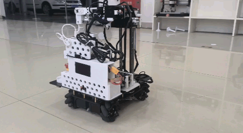
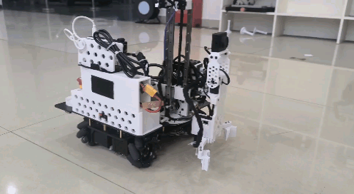
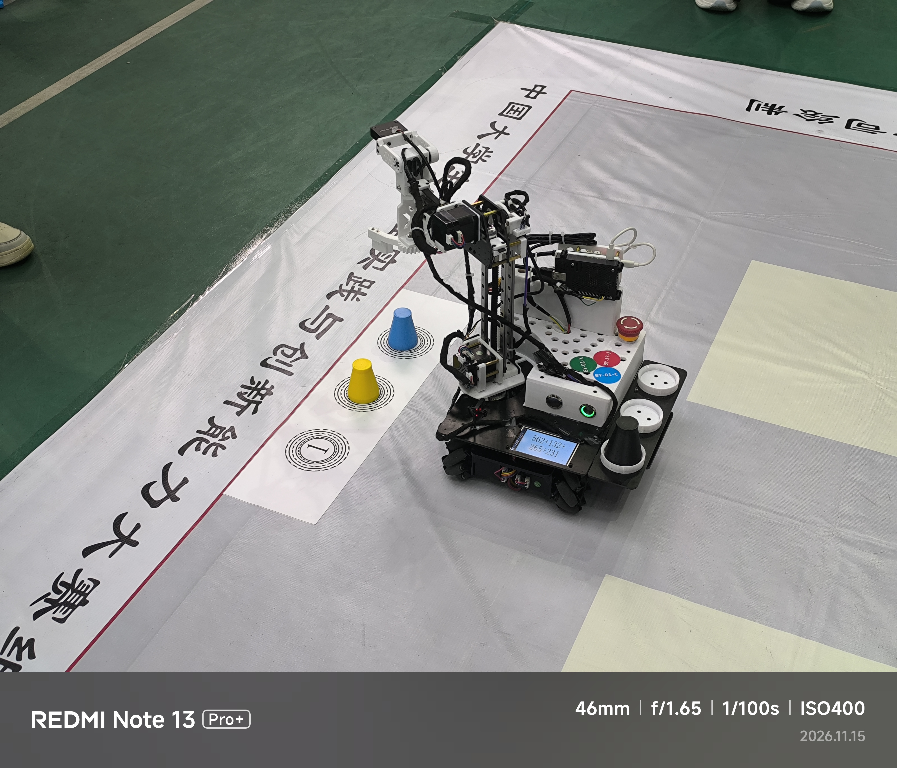

# T-Car · 2026 四川省大学生工程实践与创新能力大赛 物流小车

> 成都理工大学工程技术学院 · 核聚Robot俱乐部
> 2026 四川省大学生工程实践与创新能力大赛 · 物流小车赛项

本仓库为本队伍参加 **2026 年四川省大学生工程实践与创新能力大赛（物流小车赛项）** 的整车控制项目存档（项目代号 T-Car，工程名 `Hurri-Cargo_Code`），包含 STM32 嵌入式控制源码、调试工具与相关文档，供后续队员及校内外参赛队伍参考学习。

> **框架来源**：本项目整体由 [Pcb-yun/LogCar](https://github.com/Pcb-yun/LogCar) 项目的框架修改得到，LogCar 提供了本项目的目录结构、应用分层、驱动移植与工具链基础。在此对 [Pcb-yun](https://github.com/Pcb-yun) 的开源工作表示特别鸣谢。

> **版本说明**：本仓库代码并非比赛当时实际使用的版本，部分模块在赛后进行了重构；如有需要请联系作者。

## 项目展示







## 项目概览

项目整体分为 **电控（STM32）**、**视觉（树莓派）**、**机械** 三方面：

| 方向 | 说明                                                         | 代码 / 资源位置                                                |
| :- | :--------------------------------------------------------- | :------------------------------------------------------- |
| 电控 | STM32F407ZGT6 主控，负责底盘运动、OPS 定位闭环导航、机械臂/物料盘控制、任务调度与调试 Shell | `Core/`、`Drivers/`、`Applications/`、`MDK-ARM/`            |
| 视觉 | 树莓派 + Python/OpenCV，负责颜色识别与圆盘/圆环视觉二次标定，通过串口与主控通信           | `vision/`（树莓派端 Python 视觉代码）、`Drivers/User/RPI/`（主控侧通信链路） |
| 机械 | 四轮麦轮底盘 + 三轴圆柱坐标机械臂（旋转 / 伸缩 / 升降）+ 夹爪、物料盘、相机翻转              | 结构模型不在本仓库；实物展示见 `media/`                                 |

### 目录结构

```text
T-Car/
├── Applications/                     # 应用层（任务、导航、底盘、机械臂、规划器、Shell）
├── Core/                             # STM32CubeMX 生成：HAL、FreeRTOS、中断、时钟等
├── Drivers/                          # HAL/CMSIS 驱动与自研外设驱动（User 目录）
├── Middlewares/                      # 第三方中间件（FreeRTOS、CMSIS-DSP）
├── MDK-ARM/                          # Keil MDK 工程、启动文件与分散加载
├── media/                            # 项目展示照片与动图
├── vision/                           # 树莓派端视觉代码（Python + OpenCV）
├── .eide/                            # EIDE（VS Code）工程配置
├── Hurri-Cargo_Code.ioc              # STM32CubeMX 工程文件
├── Hurri-Cargo_Code.code-workspace   # VS Code 工作区
├── format_code.ps1                   # clang-format 批量格式化脚本
└── LICENSE                           # GPL-3.0 许可证
```

## 电控（STM32）

### 硬件架构

| 部件   | 说明                                                  | 通信方式                           |
| :--- | :-------------------------------------------------- | :----------------------------- |
| 主控板  | 正点原子 STM32F407ZGT6 开发板（现成开发板，非自绘核心板）                | —                              |
| 底盘   | 麦克纳姆轮 × 4，全向移动                                      | ZDT-X42S 闭环步进电机，USART6（921600） |
| 机械臂  | 三轴圆柱坐标（旋转 / 伸缩 / 升降）+ 夹爪、物料盘、相机翻转舵机；采用轻触开关 / 光电开关整零 | 步进 USART6；总线舵机 USART3（115200）  |
| 平面定位 | OPS 平面定位模块                                          | UART4（115200）                  |
| 扫码   | 条码扫描枪                                               | UART5（115200）                  |
| 视觉   | 树莓派 + 摄像头                                           | USART2（115200）                 |
| 显示   | ILI9488 480×320 TFT LCD                             | SPI1                           |
| 人机交互 | START 按键、DIP 拨码、LED、蜂鸣器                             | GPIO                           |
| 电源监测 | 电池电压（经总线舵机回传）                                       | USART3                         |
| 调试终端 | USB-TTL 串口                                          | USART1（1000000）                |

详细引脚与外设配置见 `Hurri-Cargo_Code.ioc` 及 `Core/Src/*.c`。

### 软件架构

固件基于 STM32 HAL + FreeRTOS（CMSIS-RTOS2）开发，应用层按功能模块化组织：

```text
Applications/
├── mission/          # 总任务调度（扫码、两轮物料搬运、视觉标定、路线执行）
│   ├── utils/        # 任务动作 / 路线表 / 导航封装 / 任务码 / 显示 / 计时
│   └── tools/        # mission 调试命令
├── nav/              # 导航（OPS 定位融合、5 ms 闭环控制、地图点位、主机端仿真）
│   ├── localization/
│   ├── utils/
│   ├── tools/
│   └── tests/        # 主机端仿真 harness（gcc）
├── chassis/          # 底盘控制（麦轮逆运动学、运动控制、旋转中心标定）
│   ├── kinematics/
│   ├── motion/
│   └── pytools/      # pivot_cal.py 旋转中心标定工具
├── arm/              # 机械臂控制（三轴圆柱坐标、动作序列、回零、夹爪/物料盘）
│   ├── utils/        # arm_action / arm_motion / arm_ctrl / arm_kinematics
│   └── tools/        # arm 调试命令
├── Planner/          # 路径规划（A*，重构版默认启用）
└── letter_shell/     # 串口命令行 Shell（含 log 与 shell_enhance）

Drivers/User/         # 自研外设驱动
├── BATTERY/          # 电池电压监测
├── BUZZER/           # 蜂鸣器 + 乐谱
├── DIP_SW/           # 启动区拨码开关
├── KEY/              # START 按键
├── LCD/              # ILI9488 显示驱动与字库
├── MISC/             # dmesg 启动自检打印
├── OPS/              # OPS 平面定位模块
├── RPI/              # 树莓派通信链路
├── RTOS/             # 任务 / 内存统计工具
├── SCANNER/          # 条码扫码模块
├── SERVO/            # 总线舵机 + PWM 舵机
└── STEP/             # ZDT-V5 闭环步进电机驱动（含 zdt-v5-driver）
```

主要功能：

- **闭环导航**：OPS 定位（x/y/yaw）+ 5 ms 闭环控制（梯形速度规划 + 航向 PID + 位置反馈），支持到点停稳判定、OPS 断帧保护、`nav par` 在线整定与 `nav trace` CSV 遥测；
- **任务调度**：双启动区（DIP 拨码选择）、两轮物料搬运、扫码任务码（`xxx+xxx+xxx+xxx`）、每个任务点可配置树莓派视觉二次标定，并支持单步失败软处理继续执行；
- **机械臂**：三轴圆柱坐标运动学、外部轻触 / 光电限位开关整零（ZDT 固件回零）、逐点预设位姿（实车标定参数）、夹爪/物料盘/相机翻转舵机控制、单轴回零；
- **底盘**：四轮麦轮逆运动学（旋转中心可偏移标定）、ZDT 闭环步进电机三通道分级命令链；
- **路径规划**：方形车体净空场 A\* 与旋转安全点方案，核心算法魔改自 [NoeticMaze](https://github.com/StarDust-XCHH/NoeticMaze)（MIT）；重构版本已做规划器内存优化并默认启用本地规划（`PLANNER_ENABLED=1`）；
- **调试**：letter shell 命令组、分级日志、LCD / 蜂鸣器提示、上电 dmesg 自检。

#### 任务流程

START 按键或 `mission run` 启动 → OPS 清零 → 导航至扫码点并读取任务码 → 两轮循环：原料区按颜色抓取 3 件物料上盘 → 粗加工区按任务码格位放置（第一/二层）→ 取回物料 → 暂存区叠放 → LCD 显示完成 → 返回 HOME。

#### 调试与使用

通过 USART1（1 Mbps、8N1）连接串口终端即可进入 letter shell，常用命令：

| 命令                                         | 说明                        |
| :----------------------------------------- | :------------------------ |
| `help`                                     | 查看全部命令                    |
| `mission run` / `stop` / `time`            | 启动 / 中止任务，查看任务与分阶段耗时      |
| `nav pose` / `go` / `to` / `par` / `trace` | 查看位姿、按点位或坐标导航、在线整定、CSV 遥测 |
| `car info` / `bus`；`step bus q`            | 底盘参数、电机命令链与总线统计           |
| `arm pos` / `preset` / `act`               | 机械臂位姿读取、预设位姿、完整动作         |
| `ops view` / `zero`；`rpi stat`             | OPS 定位数据；树莓派链路统计          |

更多命令与整定方法见各模块文档：`Applications/arm/README.md`、`Applications/chassis/README.md`、`Applications/Planner/README.md`、`Drivers/User/RPI/README.md`。

#### 第三方子模块

| 子模块                                               | 说明                                                            | 来源                                                                | 许可证     |
| :------------------------------------------------ | :------------------------------------------------------------ | :---------------------------------------------------------------- | :------ |
| [zdt-v5-driver](Drivers/User/STEP/zdt-v5-driver/) | 张大头 V5 系列步进电机通用驱动库（串口版），支持 X42/X42S/Y42 全系列；**本仓库版本已针对本项目修改** | [Pcb-yun/zdt-v5-driver](https://github.com/Pcb-yun/zdt-v5-driver) | GPL-3.0 |

> **注意（重要）**：本仓库内置的 `zdt-v5-driver` 已针对本项目进行修改（接口适配、FreeRTOS 命令链、收发时序与状态机等），与上游 `Pcb-yun/zdt-v5-driver` 源码**已产生差异**。**请勿使用上游最新源码直接覆盖 / 更新本目录**，否则可能破坏本项目已有的适配与实车验证结果；如需同步上游改进，请先 diff 对比、逐项移植，并在实车上验证收发时序与电机行为。
>
> 本仓库将 `zdt-v5-driver` 以源码方式内置（非 git submodule），克隆仓库后无需执行 `git submodule update --init --recursive`。

### 开发环境

本项目使用 VS Code + EIDE（Embedded IDE）插件进行编译、烧录与调试。仓库内自带 EIDE 工程配置（`.eide/` 目录），可无缝衔接：

1. 安装 [VS Code](https://code.visualstudio.com/) 及 [EIDE 插件](https://marketplace.visualstudio.com/items?itemName=CL.eide)；
2. 用 VS Code 打开本仓库，通过 EIDE 加载 `.eide/eide.yml` 工程（或直接打开 `Hurri-Cargo_Code.code-workspace`）；
3. 选择目标芯片（STM32F407ZGTx）、Arm Compiler 5 工具链与调试器（默认 OpenOCD + CMSIS-DAP）后，即可一键编译、烧录、调试。

> 仓库同时保留 Keil MDK 工程（`MDK-ARM/Hurri-Cargo_Code.uvprojx`），可按需选用。

## 视觉（树莓派）

树莓派端视觉代码位于 `vision/`，使用 **Python 3 + OpenCV** 编写，运行在树莓派上，通过串口与主控通信：

- **运行环境**：树莓派 + USB 摄像头（V4L2、MJPG 1280×720@30），依赖见 `vision/requirements.txt`（`opencv-python`、`numpy`、`pyserial`）；
- **通信接口**：树莓派串口 `/dev/ttyAMA0`（115200、8N1）连接主控 USART2；主控下发单字节命令，树莓派返回 `[0xFE, 负载..., 0xEF]` 应答帧，约每 100 ms 重复发送直到收到新命令或空闲命令 `0x11`；
- **相机标定**：`config/realtek_rgb_camera.yaml` 为相机内参与畸变参数，更换相机 / 镜头后需重新标定；
- **运行方式**：在树莓派上进入 `vision/` 目录，先执行 `pip install -r requirements.txt` 安装依赖，再执行 `python3 main.py`，窗口显示识别结果与 FPS（按 `q` 退出）；`cv2.imshow` 需要图形界面（桌面或 VNC），无显示环境时需自行改为无窗口模式。

| 文件 / 目录                                  | 功能                                            |
| :--------------------------------------- | :-------------------------------------------- |
| `main.py`                                | 主程序：串口命令循环、相机采集、检测器调度与结果回传                    |
| `yanse.py`                               | 颜色识别（HSV 阈值）                                  |
| `material_pickup_detector.py`            | 高位视角物料颜色、位置与停稳检测                              |
| `wuliaopan.py` + `turntable_detector.py` | 300 mm 转盘外圆检测与圆心 / 半径精定位                      |
| `yuanhuan.py`                            | 三圆环工位识别、稳定判定与视觉对位计算                           |
| `yuanhuan2.py`                           | 码垛 / 叠层圆环识别                                   |
| `shuzi.py`                               | 数字识别（模板匹配）                                    |
| `windows.py`                             | 离线调试：不接串口，多检测器可视化                             |
| `test_speed.py`                          | 检测处理速度测试                                      |
| `上位机调试.py`                               | PC 端一体化调参上位机（滑条实时调参）                          |
| `config/`                                | 相机标定与各检测器参数配置（JSON / YAML）                    |
| `templates/`、`custom_templates/`         | 圆环 / 数字识别模板图片                                 |
| `mnist.onnx`                             | 数字识别模型文件（预留）                                  |
| `requirements.txt`                       | Python 依赖清单（opencv-python / numpy / pyserial） |

主控与树莓派之间的命令字（MCU → 树莓派）与应答帧格式，主控侧实现见 [Drivers/User/RPI/README.md](Drivers/User/RPI/README.md) 与 `Drivers/User/RPI/rpi_config.h`。

## 机械

- **底盘**：四轮麦克纳姆轮全向移动，ZDT-X42S 闭环步进电机驱动；
- **机械臂**：三轴圆柱坐标结构（基座旋转 + 同步带伸缩 + 升降），末端舵机夹爪，配总线舵机物料盘与相机翻转舵机；
- 结构模型 / 图纸不在本仓库；机械臂尺寸、限位与位姿参数见 `Applications/arm/arm_config.h`，实物展示见 `media/`。

### 机械臂特点

- **整零方式**：三轴均使用 **ZDT 电机固件内置的「限位回零」（模式 3）**，各轴零位端安装 **轻触开关 / 光电开关** 作为限位触发信号；电机以低速（默认 60 RPM）顶向限位端，触发后由固件把该点记录为机械零位，应用层只负责写入回零参数（模式 / 方向 / 速度 / 超时）并轮询回零状态。
- **回零顺序**：整臂回零按「升降（先抬离台面）→ 伸缩（收短）→ 基座（最后转、扫掠最小）」串行执行，并支持 `arm home <轴>` 单轴回零；整臂回零放在低优先级任务中异步执行，避免阻塞控制链。默认上电不自动回零（`ARM_AUTO_HOME_ON_INIT=0`），需要时用 `arm init` 手动触发。
- **限位与换算**：软件行程限位 + 目标超限自动钳位；位置命令与回读使用不同脉冲基准（3200 脉冲/圈 vs 65536/圈，相差 20.48 倍），换算集中在 `arm_ctrl.c` 轴表中处理。
- **维护建议**：ZDT 闭环步进固件还内置多种找零模式——`00` 单圈就近回零、`01` 单圈方向回零、`02` 无限位碰撞回零、`03` 限位回零（当前使用）、`04` 回到绝对位置零点、`05` 回到上次掉电位置。后续维护者可以尝试改用 `00/01/02` 等找零方式，减少外部限位开关与整车布线依赖；改动前务必在实车上验证回零重复精度与碰撞安全，并保留软件限位兜底。

## 致谢

本项目使用了以下开源项目，在此向各位作者表示诚挚的感谢：

| 开源项目                                                         | 用途                                                              | 作者                                    | 许可证                       |
| :----------------------------------------------------------- | :-------------------------------------------------------------- | :------------------------------------ | :------------------------ |
| [LogCar](https://github.com/Pcb-yun/LogCar)                  | 项目整体框架（目录结构、应用分层、驱动移植、工具链）                                      | [Pcb-yun](https://github.com/Pcb-yun) | GPL-3.0                   |
| [zdt-v5-driver](https://github.com/Pcb-yun/zdt-v5-driver)    | ZDT-V5 闭环步进电机通用驱动（`Drivers/User/STEP/zdt-v5-driver/`）           | [Pcb-yun](https://github.com/Pcb-yun) | GPL-3.0                   |
| [NoeticMaze](https://github.com/StarDust-XCHH/NoeticMaze)    | Planner 路径规划核心算法参考（A\* 搜索 / 优先队列，本项目在其基础上针对方形车体与嵌入式约束魔改）        | StarDust-XCHH                         | MIT                       |
| [letter-shell](https://github.com/NevermindZZT/letter-shell) | 嵌入式命令行 Shell（`Applications/letter_shell/`）                      | NevermindZZT                          | MIT                       |
| [FreeRTOS](https://www.freertos.org/)                        | 实时操作系统内核（`Middlewares/Third_Party/FreeRTOS/`）                   | FreeRTOS / Richard Barry              | MIT                       |
| STM32F4 HAL / CMSIS                                          | STM32 底层驱动与内核（`Drivers/CMSIS/`、`Drivers/STM32F4xx_HAL_Driver/`） | STMicroelectronics / ARM              | BSD-3-Clause / Apache-2.0 |
| CMSIS-DSP                                                    | 预编译 DSP 数学库（`Middlewares/ST/ARM/DSP/`）                          | ARM                                   | Apache-2.0                |

再次感谢 [Pcb-yun](https://github.com/Pcb-yun) 提供的 LogCar 框架与 zdt-v5-driver 驱动，本项目由其框架修改得到；同时感谢 [StarDust-XCHH](https://github.com/StarDust-XCHH) 开源的 NoeticMaze，本项目 Planner 模块的核心规划算法在其基础上魔改而来。

## 开发者

| 开发者                | 方向 / 角色                                | 联系方式                                                                     |
| :----------------- | :------------------------------------- | :----------------------------------------------------------------------- |
| MIKECROND          | 电控 · 导航 / 任务 / 机械臂 / 整定；硬件 · 线材焊接 / 接线 | <3025780005@qq.com> · [GitHub](https://github.com/MIKECROND)             |
| hhhhhhywbx-netizen | 视觉 · 树莓派视觉开发                           | <hhhhhhywbx@gmail.com> · [GitHub](https://github.com/hhhhhhywbx-netizen) |
| 欣投柚哈树              | 机械 · 机械设计                              | <2450362413@qq.com>                                                      |
| 920fr7             | 协作 · 后勤与场务支持                           | —                                                                        |

## 说明

> **关于本项目的特殊性（写给后续维护者）**：本车从零开始搭建到正式参加比赛**不足一周**，时间紧、任务重，很多结构、走线与参数是现场边调边定；整车走线比较凌乱（**线材乱飞**），代码中 **AI 辅助的比例较高**，部分实现属于"先跑通、再整理"的比赛产物，工程整洁度、命名统一性与文档完整度都有欠缺。这些不代表团队的工程标准，恳请后来的维护者理解与包涵；也欢迎在理解现状的基础上继续重构、整理与完善。

- 本仓库部分代码使用 AI 辅助编写，风格、注释与实现方式可能不完全统一，请以实车验证与模块文档为准。
- 本项目为竞赛项目存档，机械臂位姿、任务点坐标、视觉标定偏移等参数与具体整车、场地强相关，直接烧录不会自动获得正确动作，请按实车重新标定。
- 树莓派视觉代码位于 `vision/`；机械结构模型与 PCB 设计文件不在本仓库中。
- `zdt-v5-driver` 的修改与更新注意事项见「第三方子模块」小节。
- `vision/config/` 中的相机标定与各检测器参数按实车摄像头 / 场地标定，更换硬件或场地后需要重新标定。
- **Planner 已启用（RAM 已优化）**：重构版本将地图与 A\* 工作缓冲放入 SRAM2 专用段并改用共享内存池，规划器已可启用，`PLANNER_ENABLED` 默认为 1；规划参数、评测与限制见 [Applications/Planner/README.md](Applications/Planner/README.md) 与「致谢」。

## 许可证

本项目使用 [GPL-3.0](LICENSE) 开源协议，详见仓库根目录 `LICENSE` 文件。由于本项目基于 GPL-3.0 的 LogCar 框架修改得到，整体按 GPL-3.0 发布。

包含的第三方组件协议：

| 组件                         | 协议           |
| :------------------------- | :----------- |
| LogCar 框架 / zdt-v5-driver  | GPL-3.0      |
| NoeticMaze（路径规划算法参考）       | MIT          |
| FreeRTOS                   | MIT          |
| letter-shell               | MIT          |
| STM32F4 HAL / CMSIS Device | BSD-3-Clause |
| ARM CMSIS Core / CMSIS-DSP | Apache-2.0   |
